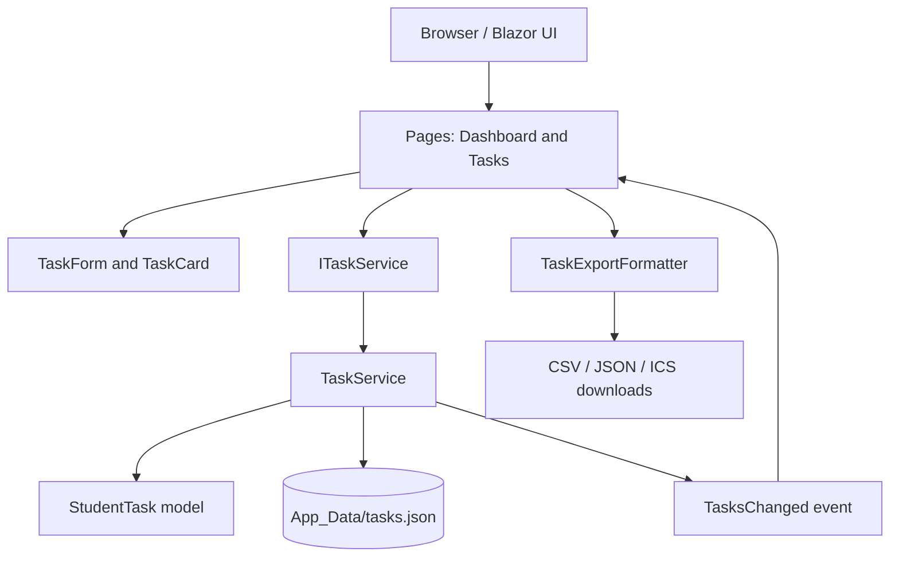

# Architecture and Design

## Architectural style

The application uses a small layered architecture with dependency injection and reusable Razor UI components. The UI depends on the `ITaskService` contract rather than constructing the persistence service directly.

## Main responsibilities

| Layer | Files | Responsibility |
|---|---|---|
| Presentation | `Components/Pages/*.razor` | Routes, page composition, user interaction and feedback |
| Reusable UI | `Components/Shared/TaskForm.razor`, `TaskCard.razor` | Encapsulated form and task-card interactions using parameters and EventCallbacks |
| Domain model | `Models/StudentTask.cs` | Task fields, validation metadata and overdue calculation |
| Application contract | `Services/ITaskService.cs` | Defines task operations and change notifications |
| Application/persistence service | `Services/TaskService.cs` | Validation, state transitions, thread-safe snapshots, JSON persistence and recovery handling |
| Export utility | `Services/TaskExportFormatter.cs` | Pure CSV, JSON and iCalendar formatting, separated for testing |
| Hosting | `Program.cs` | Dependency injection, middleware, health endpoint and Blazor endpoint mapping |

## State and data flow

1. A page receives `ITaskService` through dependency injection.
2. The service loads the task list from `App_Data/tasks.json` when the application starts.
3. A UI command is validated by the component and again by the service boundary.
4. The service creates a candidate snapshot under a lock and persists it before publishing the new in-memory state.
5. A `TasksChanged` event tells connected components to refresh their view.
6. Pages derive filtered/sorted views and dashboard statistics from the current service snapshot.

## Design decisions

- **Dependency inversion:** UI pages depend on `ITaskService`, not a concrete storage implementation.
- **Encapsulation:** callers receive cloned snapshots so they cannot mutate internal state without a service operation.
- **Thread safety:** service mutations and snapshots are protected by a synchronization lock.
- **Persistence resilience:** writes use a unique temporary file in the data directory and replace the target only after the write is flushed. Invalid JSON is preserved in a recovery copy.
- **Event resilience:** one failing UI subscriber does not make a successfully persisted mutation appear to fail.
- **Reusable components:** `TaskForm` and `TaskCard` expose parameters and `EventCallback` contracts.
- **Testability:** export formatting is pure logic and can be tested without a browser.

## Security and deployment boundary

Razor encodes normal text output. Form and service validation constrain input. Baseline security headers are added in the HTTP pipeline. The current project intentionally has no authentication, authorization, or per-user ownership and stores one shared task board. The JSON file store is single-instance coursework storage, not a distributed production database. A production evolution should introduce an EF Core database provider, migrations, user identity, authorization policies, backup/restore procedures and observability.
